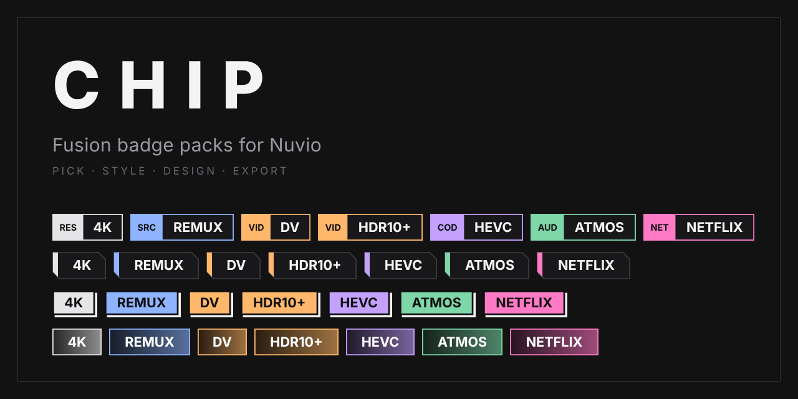
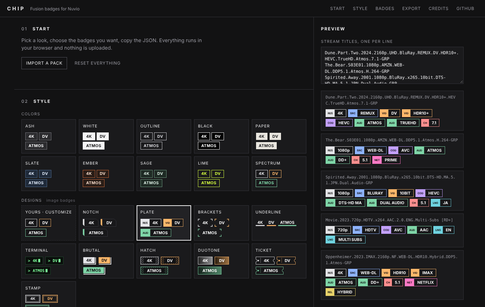
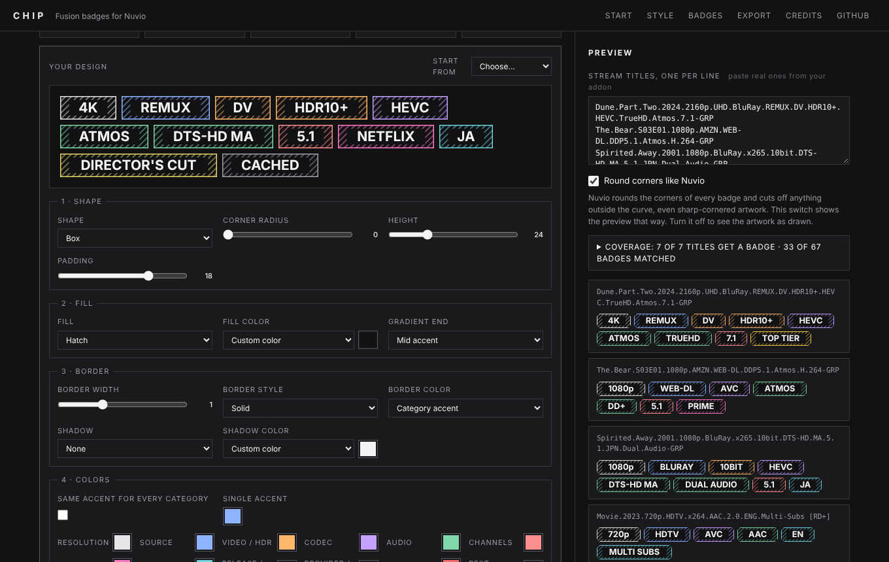

<div align="center">



# Chip

**Pick badges, style them, design your own, export a pack for Nuvio.**
Minimal, square-edged, entirely in your browser.

[](https://aljaz-h.github.io/chip/)

</div>

---

Chip is a static editor for Nuvio Fusion stream badge packs. There is no server, no account and no build step. Everything runs in your browser and nothing is uploaded.



## How to use it

1. Open **[aljaz-h.github.io/chip](https://aljaz-h.github.io/chip/)**.
2. Pick a look, switch the badges you want on or off, and check them against real stream titles in the preview.
3. In **Export**, choose **GitHub Gist** (recommended). Create a token that only has the *gist* permission (the button opens the right page), paste it once, and click **Publish to Gist**. You get a link that never changes, so you can update the pack later and keep the same URL. No token? Use **Manual Gist**: it copies the pack and opens gist.github.com, and the site turns your gist's address into the link.
4. In Nuvio open **Settings → Streams → Fusion badge URLs** (Android TV: **Settings → Layout → Streams**), paste the link, tap **Import**, then select it as the active pack. Menu labels can differ between versions.

## What it does

- **105 badges in 10 categories**: resolution, source, video/HDR, codec, audio, channels, streaming service, language, release/edition, and provider/cache.
- **10 color presets**: Ash, White, Outline, Black, Paper, Slate, Ember, Sage, Lime, Spectrum.
- **10 experimental designs** drawn as artwork (PNG, rendered from SVG): Notch, Plate, Brackets, Underline, Terminal, Brutal, Hatch, Duotone, Ticket, Stamp.
- **Your own design**: shape, border, fill, accent bar, category tag, shadow, font, spacing, and an accent color per category, with a live preview and a contrast warning.
- **Live preview** against stream titles you paste, plus a health check on the pack.
- **Import** an existing pack by paste, file or raw URL, edit it, and export it again.
- Reorder badges and categories, and add your own badges with a custom regex.



## Using your own design

Custom designs are drawn as one PNG per badge, so Nuvio has to download them from a public address.

1. Build the design, then in **Export** click **Download artwork (ZIP)**.
2. Unzip it into your repo's `badges/` folder so the files sit at `badges/custom/`, then commit and push.
3. Leave **Hosted at** empty (it points at the site's own `badges/` folder) and import the exported JSON into Nuvio.

Re-download and re-upload the ZIP whenever you change the design or rename a badge. There is also an experimental option to embed the artwork inside the JSON (about 260 KB). It is untested in Nuvio.

## Run your own copy

Fork the repo, then **Settings → Pages → Deploy from a branch → `main` / root**. Change `aljaz-h` in `index.html` (link previews) and `README.md` to your own account.

## Changing or adding badges

The catalog and the style presets live in `tools/build.py`. Edit the `B` list (badges) or `PRESETS` (styles), then regenerate `catalog.js`, the SVGs and the PNGs (needs `rsvg-convert`, from librsvg):

```
pip install pillow fonttools
python3 tools/build.py .
```

The script reads Inter Bold and DejaVu Sans Mono Bold from Linux paths (`INTER` and `MONO_FILE`) and draws the labels as outlines, so it also needs `pip install fonttools`. Change the paths to any bold fonts on your machine.

## Honest limits

- Your GitHub token is kept only in your browser and sent only to `api.github.com`. It is remembered only if you tick the box. Use a token with just the *gist* permission.
- I tried free paste sites (paste.rs, dpaste) for one-click links and removed them: an Android device rejected dpaste's security certificate during import, and paste sites can expire links. Gist links worked.
- Patterns are tested here with JavaScript regex. Nuvio uses its own engine, so check a few real streams after importing.
- The **Provider / Cache** category depends on how your addon words its results (for example `[RD+]`). Adjust those patterns to match what you see.
- Badges match *text*. A badge says what the release name says, not what the file contains.
- Artwork designs are still only lightly tested in Nuvio. My first version used SVG files, and Nuvio showed the shapes with no label inside. Badger and Nuvio's own examples use PNG for image badges, so every design now ships as a 3x PNG, with labels drawn as outlines, and image links carry a `?v=` tag so Nuvio fetches new files instead of cached ones. If something still looks wrong, open an issue and say which design.
- The pack format (`groups` and `filters` with `tagStyle`, colors, `imageURL`) was taken from public Nuvio documentation and public packs. The tag style `filled` is assumed from Badger's own example. `bordered` and `filled and bordered` appear in public packs.

## Credits

Chip follows an idea other people built first. See **[CREDITS.md](CREDITS.md)**, in particular [Badger](https://github.com/Nintle/Badger) by Nintle and [Nuvio Badge Studio](https://itsvoidog.github.io/nuvio-badge-studio/) by Voidxo. The catalog, patterns, artwork and code in this repository were written for this project.

Not affiliated with Nuvio, Stremio or any streaming service. Names belong to their owners.
