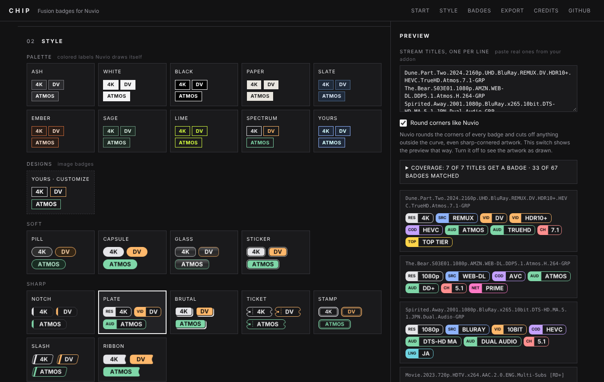

<div align="center">


# Chip

**Pick badges, style them, design your own, export a pack for Nuvio.**
Minimal, square-edged, entirely in your browser.

[](https://aljaz-h.github.io/chip/)

</div>

---

Chip is a static editor for Nuvio Fusion stream badge packs. There is no server, no account and no build step. Everything runs in your browser and nothing is uploaded.


## How to use it

1. Open **[aljaz-h.github.io/chip](https://aljaz-h.github.io/chip/)**.
2. Start from a **starter pack** (or switch badges on and off yourself), pick a **look**, and check it against real stream titles in the preview. A look is either a *palette + fill style* (Nuvio draws it, nothing to host) or one of the *designs* (artwork images).
3. In **Export**, choose **GitHub Gist** (recommended). Create a token that only has the *gist* permission (the button opens the right page), paste it once, and click **Publish to Gist**. You get a link pinned to that version. Each time you update the pack you get a new link, because that is what makes Nuvio and GitHub fetch the fresh copy instead of a cached one. No token? Use **Manual Gist**: it copies the pack and opens gist.github.com, and the site turns your gist's address into the link.
4. In Nuvio open **Settings → Streams → Fusion badge URLs** (Android TV: **Settings → Layout → Streams**), paste the link, tap **Import**, then select it as the active pack. Menu labels can differ between versions.

## What it does

- **112 badges in 12 categories**: resolution, source, video/HDR, codec, audio, channels, streaming service, language, release/edition, provider/cache, **warnings** (low quality, upscaled, sample, dubbed) and **best match** combinations (for example 4K + HDR + lossless audio).
- **Starter packs**: Recommended, Minimal, Remux hunter, Anime, Audio nerd, Languages and Everything. One click sets which badges are on.
- **Palette + fill style**: pick a palette (Ash, White, Black, Paper, Slate, Ember, Sage, Lime, Spectrum, or your own color), then choose Filled, Bordered, Filled + border or Soft. Nuvio draws these itself, so nothing needs hosting.
- **Rounded or sharp corners** for every design. Rounded is the default because Nuvio clips badges to a curve; sharp is there for if that changes.
- **21 designs in four groups** drawn as artwork (PNG, rendered from SVG): *Soft* (Pill, Capsule, Glass, Sticker), *Sharp* (Notch, Plate, Brutal, Ticket, Stamp, Slash, Ribbon), *Technical* (Brackets, Terminal, Hatch, Duotone, Neon, LCD) and *Minimal* (Underline, Glyph, Bare, Shine, Dot). Glyph uses a small generic icon per category, no brand logos.
- **Your own design**, built in five layers (shape, fill, border, colors, content) plus text, with a live preview and a contrast warning. Start from any recipe.
- **Borrow images from another pack**: paste a pack's link and Chip uses its logo images for the badges it recognizes (matched by name). The images stay on the other author's server and they are credited on the page.
- **Live preview** against stream titles you paste, a coverage report (titles that get no badge, badges that never matched) and a health check on the pack.
- **Save or share your setup** as a file or a link that rebuilds it anywhere. It never includes your GitHub token.
- **Import** an existing pack by paste, file or raw URL, edit it, and export it again.
- Reorder badges and categories, and add your own badges with a custom regex.




## Using your own design

Your design is drawn in your browser as one PNG per badge.

- **Embedded (default):** the images go inside the JSON, so the Gist link alone is enough and nothing needs hosting. Badger works the same way. If badges come out empty in Nuvio, untick *Embed* in Export.
- **Hosted:** click **Download artwork (ZIP)**, unzip it into your repo's `badges/` folder so the files sit at `badges/custom/`, commit and push, and leave **Hosted at** empty (it points at the site's own `badges/` folder).

## Run your own copy

Fork the repo, then **Settings → Pages → Deploy from a branch → `main` / root**. Change `aljaz-h` in `index.html` (link previews) and `README.md` to your own account.

## Project layout

| Path | What it is |
| --- | --- |
| `index.html`, `style.css`, `app.js` | The whole site: plain HTML, CSS and JavaScript, no build step |
| `catalog.js` | Generated: badges, patterns, presets, starter packs, credits |
| `badges/` | Generated artwork, one folder per design (`<design>/` and `<design>-round/`), 4x PNG |
| `tools/build.py` | Generates `catalog.js` and the artwork |
| `assets/` | README screenshots and the social preview |

## Changing or adding badges

The catalog, palettes, designs and starter packs live in `tools/build.py`. Edit the `B` list (badges), `PRESETS` (palettes), the `d_*` functions (designs) or `PACKS` (starter packs), then regenerate:

```
pip install pillow fonttools
sudo apt install librsvg2-bin    # provides rsvg-convert
python3 tools/build.py .
```

The script draws every label as vector outlines using Inter Bold and DejaVu Sans Mono Bold. It reads them from Linux paths (`INTER` and `MONO_FILE`), so change those to any bold fonts on your machine. Artwork is written as SVG to a scratch folder and rendered to PNG with `rsvg-convert`. Set `CHIP_KEEP_SVG=1` to keep the SVG sources. When you change `index.html`, `app.js` or `style.css`, bump `SITE_V` in `build.py` and run it again: it stamps the `?v=` cache-busting tags and the version check.

## Honest limits

- Your GitHub token is kept only in your browser and sent only to `api.github.com`. It is remembered only if you tick the box. Use a token with just the *gist* permission.
- I tried free paste sites (paste.rs, dpaste) for one-click links and removed them: an Android device rejected dpaste's security certificate during import, and paste sites can expire links. Gist links worked.
- Embedded images (the default for your own design) have not been confirmed in Nuvio yet. Badger relies on the same approach, but if badges show up empty, untick *Embed* and host the ZIP instead. Borrowed images depend on the other pack staying online.
- Patterns are tested here with JavaScript regex. Nuvio uses its own engine, so check a few real streams after importing.
- The **Provider / Cache** category depends on how your addon words its results (for example `[RD+]`). Adjust those patterns to match what you see.
- Badges match *text*. A badge says what the release name says, not what the file contains.
- Artwork designs are still only lightly tested in Nuvio. My first version used SVG files, and Nuvio showed the shapes with no label inside. Badger and Nuvio's own examples use PNG for image badges, so every design now ships as a 4x PNG, with labels drawn as outlines, and image links carry a `?v=` tag so Nuvio fetches new files instead of cached ones. If something still looks wrong, open an issue and say which design.
- The pack format (`groups` and `filters` with `tagStyle`, colors, `imageURL`) was taken from public Nuvio documentation and public packs. The tag style `filled` is assumed from Badger's own example. `bordered` and `filled and bordered` appear in public packs.

## Credits

Chip follows an idea other people built first. See **[CREDITS.md](CREDITS.md)**, in particular [Badger](https://github.com/Nintle/Badger) by Nintle and [Nuvio Badge Studio](https://itsvoidog.github.io/nuvio-badge-studio/) by Voidxo. The catalog, patterns, artwork and code in this repository were written for this project.

Not affiliated with Nuvio, Stremio or any streaming service. Names belong to their owners.
